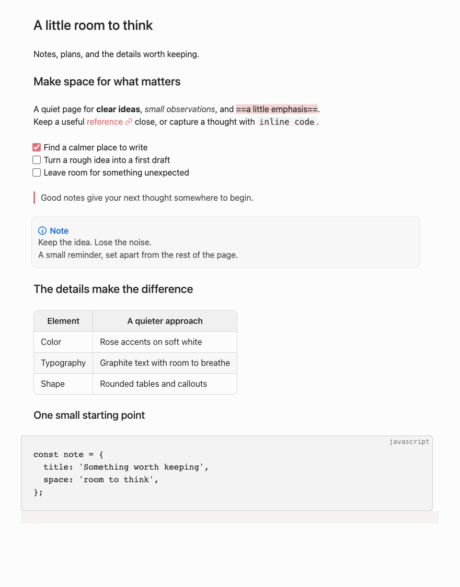
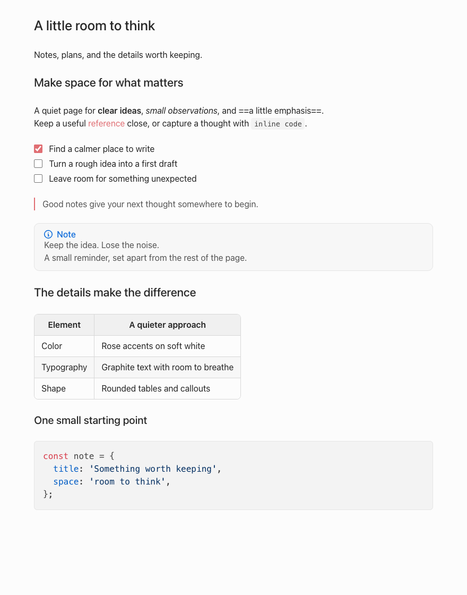

# Red Graphite for MarkEdit

A light theme for [MarkEdit](https://github.com/MarkEdit-app/MarkEdit), with rose accents, graphite text, and room to breathe. Built on [MarkEdit-theming](https://github.com/MarkEdit-app/MarkEdit-theming).

## A look inside

### Mixed mode

Write with rose highlights, comfortable task spacing, and rounded tables and callouts.



### Preview mode

Read your notes with clear headings, soft borders, and rose links.



These screenshots show the [English sample](test/fixture.md) in an isolated browser running MarkEdit’s editor and extensions.

## Install

1. Download [`markedit-theme-red-graphite.js` (v1.0.2)](https://github.com/unsnruu/markedit-red-graphite/releases/download/v1.0.2/markedit-theme-red-graphite.js).
2. Copy it to MarkEdit’s user scripts directory.
3. Restart MarkEdit.

The theme is also listed in the MarkEdit Extension Registry. It supports light mode only.

If you use custom Bear CSS or companion scripts, try the theme in a separate MarkEdit environment first. Those styles may override it. To uninstall, remove the theme’s script and restart MarkEdit.

## Quick Look companion

The optional CSS companion styles the **rendered preview** in Finder Quick Look in light mode. It reuses this theme's Preview typography, tables, quotes and callouts. Quick Look's source view and toolbar retain their original appearance; dark mode uses the preview extension's existing theme. This is a separate CSS installation, not a `themeName` value or an automatically synchronized editor setting.

Requires MarkEdit 1.37.0 and Markdown View Modes (MarkEdit-preview) 1.14.0, with MarkEdit's Quick Look extension enabled. Open MarkEdit with the preview extension installed first so it prepares its shared preview resources. Earlier versions have not been verified.

1. Open [`markedit-theme-red-graphite-quicklook.css`](dist/markedit-theme-red-graphite-quicklook.css) and use GitHub’s **Download raw file** button to save the CSS. It is included in this repository; it is not yet attached to a GitHub release. Developers can generate the same file with `yarn build`.
2. In Finder, choose **Go → Go to Folder** and open:

```text
~/Library/Group Containers/group.app.cyan.markedit/Shared/styles/
```

3. Create `styles` if needed and copy `markedit-theme-red-graphite-quicklook.css` into it.
4. Close any open Quick Look window, select a Markdown file in Finder, press Space, and choose **Preview**. Use light mode to see Red Graphite.

To update, replace that same CSS file with the newer version. To disable or uninstall, remove only that file and reopen Quick Look. Existing preview settings and other styles do not need to change. Disabling/removing the editor theme does **not** remove this separately installed companion.

Building and testing never perform this installation. The implementation follows MarkEdit's [shared CSS loader](https://github.com/MarkEdit-app/MarkEdit/blob/v1.37.0/QuickLookMac/QuickLookConfig.swift). The maintainer confirmed that the installed CSS works in Finder Quick Look on 2026-11-02. Automated verification uses the actual CoreEditor and preview extension in an isolated browser configured as the Quick Look host.

## Settings

Add this to MarkEdit’s [settings.json](https://github.com/MarkEdit-app/MarkEdit/wiki/Customization#advanced-settings):

```json
{
  "extension.redGraphite": { "enabledMode": "light" }
}
```

To disable the theme, change `light` to `none` and restart MarkEdit. Setting it to `both` still provides only the light theme.

Want different colors? See the [color customization guide](https://github.com/MarkEdit-app/MarkEdit-theming/wiki#customization).

Red Graphite uses system fonts at 16px and a maximum content width of 800px. Preview spacing follows Mixed mode as closely as possible; syntax visibility and Markdown rendering can still differ. Your tab width, document text, and editing commands stay unchanged.

## Compatibility

- [Markdown View Modes](https://github.com/MarkEdit-app/MarkEdit-preview) 1.14.0 provides Mixed and Preview modes. Enable its inline rendering options to show tables and images while editing.
- [Text Highlight](https://github.com/MarkEdit-app/MarkEdit-highlight) 1.0.0 provides highlight syntax; this theme adds the colors. Preview mode does not render `==highlights==`.
- Tested with MarkEdit 1.37.0 CoreEditor in an isolated Chrome browser. The quote fix and basic mode switching were also checked in the macOS app. IME input has not been verified. Styled HTML export and nested callouts are not covered by v1 compatibility testing.

Built with AI assistance. If something looks wrong or behaves unexpectedly, please [open an issue](https://github.com/unsnruu/markedit-red-graphite/issues).

## Development

Start with `main.ts` and the styles in `src/`. `src/preview.css` is the shared Preview style source. `scripts/quicklook.mjs` adapts its selectors to Quick Look’s content wrapper; `src/quicklook.css` contains only host layout adjustments. Edit these sources, then rebuild; do not edit `dist/` directly.

### Build

Use Node.js 22 and Yarn 1.22.22. From the repository root (`dev/` in the full local project), run:

```sh
corepack enable
yarn install --frozen-lockfile
yarn run check
yarn build
```

You’ll find the editor script, Quick Look companion CSS, SHA-256 checksums for both files, and license notices in `dist/`. The script also includes the required license notices. The distributable JavaScript and Quick Look CSS are tracked in Git; the checksum and separate license notices are generated for releases. Building only creates these files; installation is a separate step.

### Browser tests

Install Chrome, then set these variables to your local resource files:

| Variable | File |
| --- | --- |
| `MARKEDIT_HTML` | MarkEdit’s `Contents/Resources/index.html` |
| `MARKEDIT_PREVIEW_JS` | Markdown View Modes 1.14.0 release script |
| `MARKEDIT_HIGHLIGHT_JS` | Text Highlight 1.0.0 release script |

Run `yarn test` to check editing modes, narrow layouts, theme switching, disabling, and editing/undo. It also refreshes the two README screenshots in `assets/previews/`. Extra test screenshots and the verification report stay locally in `test/.generated/`.

`test/quicklook.mjs` additionally checks shared CSS loading/removal in a temporary directory, preview styling, source/toolbar isolation, dark-mode fallback, mode switching, and narrow/wide layouts. Its screenshots and verification report are written under `test/.generated/`. It never invokes Finder, `qlmanage`, or writes to a real shared container.

Tests use a temporary Chrome profile and a local server, with simulated native file and menu calls. They leave your MarkEdit files untouched. Run these tests locally; CI checks the build and verifies that committed `dist/` files match it.

## Contributing and license

For registry submissions and updates, follow the [MarkEdit contributing guide](https://github.com/MarkEdit-app/extensions#contributing). Entries go in `themes/` and use `theme.schema.json`, with `colorScheme`, `colorPatterns`, a versioned script URL, and its SHA-256. Submit updates through a pull request; Extension Manager availability depends on acceptance.

The implementation is licensed under [MIT](LICENSE). See [credits and provenance](CREDITS.md) for design references and dependency notices.

Red Graphite is an independent project, not affiliated with or endorsed by Bear or Shiny Frog. The code license does not grant rights to third-party names or designs.
