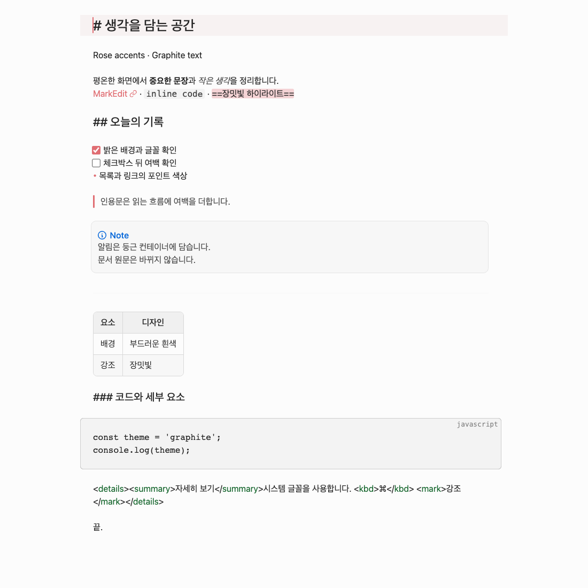
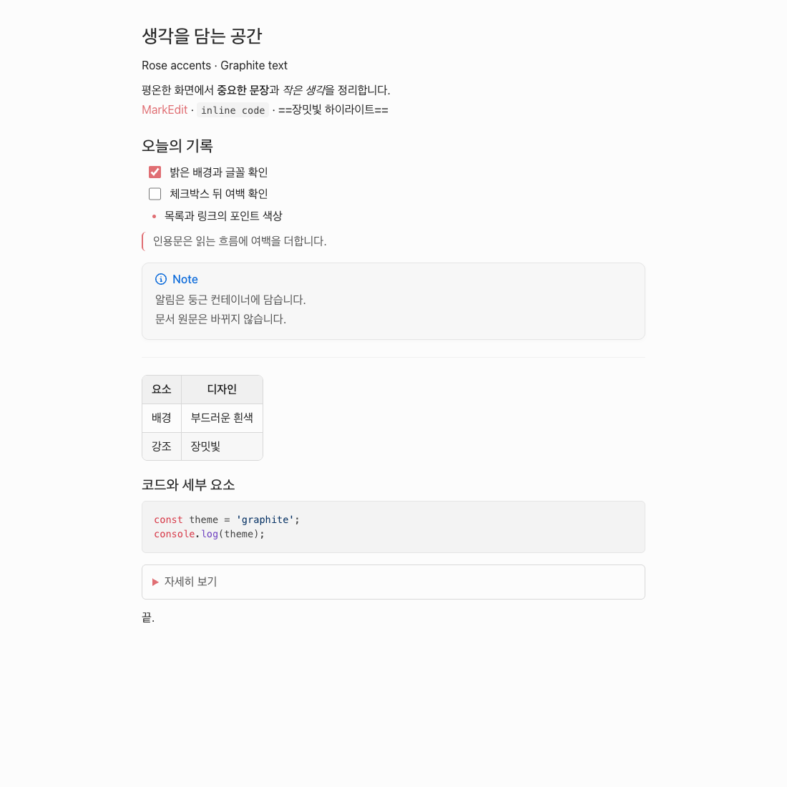

# MarkEdit-theme-bear-red-graphite

A light theme for [MarkEdit](https://github.com/MarkEdit-app/MarkEdit), built on [MarkEdit-theming](https://github.com/MarkEdit-app/MarkEdit-theming). Rose accents, graphite text, rounded tables and callouts, and comfortable checkbox spacing.

 

> Light mode only. This is an independent project, not affiliated with or endorsed by Bear or Shiny Frog. The name and design usage conditions are under review; this repository is being prepared privately and is not registered in the MarkEdit Extension Registry.

## Installation

For private review, use `dist/markedit-theme-bear-red-graphite.js` or the asset attached to the draft release. Copy the script into MarkEdit's user scripts directory and restart MarkEdit. Building this project does **not** install the theme, restart the app, or change existing files.

Use an isolated MarkEdit environment if you already have custom Bear CSS or companion scripts: those global styles can override this theme. To remove this theme, remove only its script and restart MarkEdit.

- Tested host: MarkEdit 1.37.0 CoreEditor in an isolated Chrome browser.
- [Markdown View Modes](https://github.com/MarkEdit-app/MarkEdit-preview) 1.14.0 provides Mixed/Preview rendering. Enable table/image inline rendering there when needed.
- [Text Highlight](https://github.com/MarkEdit-app/MarkEdit-highlight) 1.0.0 provides highlight syntax. This theme only supplies its colors; it does not add `==` parsing to Preview.
- Native macOS installation and IME composition have not been validated by the browser tests. Styled HTML export and nested callout rendering are outside the v1 compatibility guarantee.

## Settings

In MarkEdit's [settings.json](https://github.com/MarkEdit-app/MarkEdit/wiki/Customization#advanced-settings):

```json
{
  "extension.bearRedGraphite": { "enabledMode": "light" }
}
```

Use `none` to disable, then restart MarkEdit. `both` also applies only the supplied light theme; no dark theme is supplied. Color customization is documented by [MarkEdit-theming](https://github.com/MarkEdit-app/MarkEdit-theming/wiki#customization).

The design uses system fonts at 16px, line height 1.68 and maximum content width 800px. It does not change tab width, document content, or editing commands.

## Development

The root entry point, Vite configuration, Yarn lockfile and `dist/` layout follow [VS Code](https://github.com/MarkEdit-app/MarkEdit-theme-vscode) and [One Dark](https://github.com/MarkEdit-app/MarkEdit-theme-one-dark). Presentation styles are organized under `src/`. Unlike those examples, the helper's automatic deployment plugin is disabled.

With Node.js 22 and Yarn 1.22.22:

```sh
corepack enable
yarn install --frozen-lockfile
yarn check
yarn build
```

The build produces the single script, SHA-256, and license notices under `dist/`. The bundle contains its required license notices as well.

For the browser integration test, install Chrome and set these environment variables to local files:

- `MARKEDIT_HTML`: the installed MarkEdit application's `Contents/Resources/index.html`.
- `MARKEDIT_PREVIEW_JS`: Markdown View Modes 1.14.0 release script.
- `MARKEDIT_HIGHLIGHT_JS`: Text Highlight 1.0.0 release script.

Then run `yarn test`. The test uses an ephemeral Chrome profile and a loopback server. Native file/menu calls are test doubles. It checks Source/Mixed/Preview, narrow layout, light/dark cleanup, disabling, and editing/undo; it updates sample screenshots. CI checks the build and committed `dist/` consistency; native-resource integration tests run locally.

## Contribution and license

The [MarkEdit registry contributing guide](https://github.com/MarkEdit-app/extensions#contributing) governs registration. A theme entry belongs under `themes/`, uses `theme.schema.json`, and includes `colorScheme`, `colorPatterns`, a versioned JavaScript URL and its SHA-256. Registry submission will follow public-release readiness; a private draft URL cannot satisfy public download validation.

New implementation: [MIT](LICENSE). See [credits and provenance](CREDITS.md) for design references and bundled dependency notices. The code license does not grant rights to third-party names or designs.
